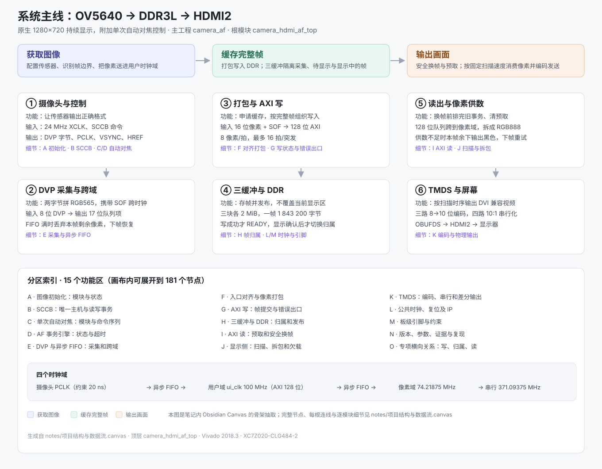

# AC880PRO 摄像头 → DDR3L 帧缓存 → HDMI 720p 点亮

基于 **AC880PRO（Zynq-7020 / XC7Z020-CLG484-2）** 的实时摄像头显示工程：OV5640 走 8 位 DVP 采集 1280×720，转 RGB565 后经 AXI4 突发写入板载 DDR3L 做三帧缓存，再由显示侧预取、对齐视频时序并做 TMDS 编码，从 HDMI2 口输出 720p 画面。

工具链：**Vivado 2018.3**。顶层模块 `camera_hdmi_af_top`（含 OV5640 自动对焦固件加载）。

> **先看结构，再看代码。**
> 完整结构画布 → [`notes/项目结构与数据流.canvas`](notes/项目结构与数据流.canvas)（181 节点 / 84 连线 / 15 个功能分区，Obsidian 打开）
> 一张图版总览 → [`docs/系统结构总览.svg`](docs/系统结构总览.svg)
> 逐图导读，从零讲起 → [`docs/从零读懂-这条链路.md`](docs/从零读懂-这条链路.md)



## 关键词与适用场景

**技术关键词**：zynq7020 / Zynq-7020 / XC7Z020、AC880PRO、OV5640、DVP、RGB565、DDR3L、MIG 7 Series、AXI4、异步 FIFO、三帧缓存、帧同步、TMDS、HDMI 720p、Verilog、Vivado 2018.3、跨时钟域 CDC、时序收敛

**用途关键词**：FPGA 教学、数字逻辑课程设计、EDA 实验课、毕业设计、学习参考、复现实验、Zynq 入门

**适合谁看**
- 做 FPGA / 嵌入式课程设计，需要一条能跑通的「摄像头 → 帧缓存 → 显示」完整链路做参考
- 想看清真实工程里 CDC 处理、AXI 突发约束、带宽核算和时序收敛怎么落地
- 自学 Zynq PL 侧设计，想对照 Vivado 工程结构、报告与源码逐层读

---

## 1. 硬件与接口

| 项 | 值 |
|---|---|
| 开发板 | AC880PRO |
| 器件 | XC7Z020-CLG484-2 |
| 摄像头 | OV5640，8 位 DVP，XCLK 24 MHz |
| 存储 | 板载 DDR3L（x16），MIG 7 Series 控制器，AXI 128 位 |
| 输出 | HDMI2（TMDS，RGB565 有效 16 位） |
| 摄像头 PCLK | 约束按 20 ns；该引脚非专用时钟脚，需 `CLOCK_DEDICATED_ROUTE FALSE` |

## 2. 数据通路

```
OV5640 (8bit DVP, 1280x720)
  └─ ov5640_capture          高字节先到 → pixel = {first_byte, second_byte}
      └─ 异步 FIFO  17bit x 2048（16bit 像素 + valid，FWFT 预取寄存器）
          └─ rgb565_packer   每 8 像素拼成 128bit 数据拍
              └─ axi_frame_writer   AXI4 INCR，最多 16 拍，不跨 4 KiB 边界
                  └─ DDR3L 三帧缓存：0x0000000 / 0x0200000 / 0x0400000，各 2 MiB
                      └─ axi_display_reader   按行预取，行首发出整行请求
                          └─ 异步 FIFO 128bit x 512（按行粒度，8 KiB）
                              └─ video_timing  1280x720 @ 1650x750
                                  └─ tmds_encoder / serializer_10to1 → HDMI2
```

帧归属由 `frame_buffer_manager` 用 5 个状态管理：`FREE / WRITING / READY / PENDING / DISPLAY`。写端只写 `FREE` 缓冲，显示端只读 `DISPLAY` 缓冲，切换在帧边界完成 —— 这是"写端不覆盖正在显示的图像"的核心。

## 3. 时钟

| 时钟 | 频率 | 来源 |
|---|---|---|
| sys_clk | 50 MHz | 板载晶振 |
| pixel_clk | 74.21875 MHz | video_clk MMCM：50 × 59.375 ÷ 4 ÷ 10 |
| serial_clk_5x | 371.09375 MHz | 同 MMCM，÷2 |
| ui_clk（AXI 用户域） | 100 MHz | MIG |
| MIG 输入 / DDR CK | 200 MHz / 400 MHz | ddr_clk |

注意：Clock Wizard 里请求值填的是 74.25 MHz，MMCM 实际输出 **74.21875 MHz**，两者不同，本文所有频率与带宽按实际值算。

## 4. 带宽与刷新率

- 帧扫描：1650 × 750 = 1,237,500 像素周期，74.21875 MHz → **59.975 Hz**（按像素时钟线性折算，未用示波器实测）
- 一帧：921,600 像素 / 1,843,200 字节（约 1.758 MiB）= 7,200 个满长度突发
- 写带宽 @30 fps：55.296 MB/s；读带宽 @59.975 fps：110.55 MB/s；合计 **165.85 MB/s**，约为 DDR 引脚侧理论 1.6 GB/s 的 10%
- 三缓冲预留 2 MiB × 2 = 4 MiB，在 1.8432 MB/帧下可安全容纳两帧

## 5. 实现结果（`delivery/upgrades/autofocus_20261109/`）

| 指标 | 值 |
|---|---|
| Slice LUTs | 7,427（13.96%） |
| Slice Registers | 8,175（7.68%） |
| Block RAM Tile | 4.5（3.21%） |
| DSP | 0（0%） |
| MMCM / PLL | 4 / 4，1 / 4 |
| WNS | +0.970 ns |
| WHS | +0.054 ns |
| TNS / THS | 0 / 0 |

原始报告见 `delivery/upgrades/autofocus_20261109/{timing,utilization,drc,methodology}.rpt`。

## 6. 仓库结构

```
rtl/camera/                   采集、打包、AXI 写读、时序、TMDS、串行器
rtl/camera_af/                含自动对焦的顶层、AF 控制器与固件 ROM
cam_yolo.srcs/sources_1/new/  被顶层复用的子模块（时序、TMDS、时钟复位、打包器等）
cam_yolo.srcs/sources_1/imports/camera_init/  OV5640 初始化寄存器表
cam_yolo.srcs/sim_1/new/      视频时序、TMDS、串行器、时钟复位等 testbench
camera_live/ip/               四个 IP 的 .xci 配置（video_clk / camera_clk / ddr_clk / MIG）
constraints/camera_hdmi.xdc   引脚与时序约束
scripts/                      构建与检查脚本
verification/                 各阶段 testbench、检查脚本与结果 JSON
delivery/upgrades/            时序/资源/DRC 报告
third_party/ov5640_af/        AF 固件上游源码与许可证
docs/                         从零导读、结构总览 SVG、阶段检查记录、TMDS 流程图
notes/                        完整结构画布（Obsidian Canvas，181 节点）
LICENSE                       授权范围与第三方权利声明
```

## 7. 重建

`delivery/upgrades/autofocus_20261109/build.tcl` 是完整的可执行构建脚本，工程根目录由脚本自身位置推导，克隆后直接跑即可：

```
cd delivery/upgrades/autofocus_20261109
vivado -mode batch -source build.tcl
```

脚本做四件事：建工程 → 加源文件与 `.xci` → 综合/实现 → 导出报告与比特流。手工重建等价步骤：

1. Vivado 2018.3，器件 `xc7z020clg484-2`
2. 加 `rtl/`、`cam_yolo.srcs/sources_1/new/`、`cam_yolo.srcs/sources_1/imports/camera_init/` 下的 `.v`，顶层 `camera_hdmi_af_top`
3. 加 `constraints/camera_hdmi.xdc`
4. `read_ip` 四个 `.xci`（`camera_live/ip/`），OOC 综合后生成对应 `.dcp`
5. 综合 → 实现 → 生成比特流

仓库不含 `.bit`、`.dcp` 与 Vivado 工程目录；IP 的 `.xci` 已包含，`.dcp` 由工具重新生成。

## 8. 第三方来源与许可证

| 来源 | 用途 | 许可 |
|---|---|---|
| [espressif/esp32-camera](https://github.com/espressif/esp32-camera) @ `281d951f75b6559adec3cdb8cf076366da103880` | OV5640 自动对焦固件（`third_party/ov5640_af/ov5640_af.c`、`ov5640_af_firmware.h`），经 `scripts/prepare_af_firmware.py` 转为 `rtl/camera_af/ov5640_af_firmware.mem` | **Apache License 2.0**，原始 `LICENSE` 逐字保留于 `third_party/ov5640_af/LICENSE`，字节数与哈希见 `upstream.json` |
| Xilinx Vivado 2018.3 IP（Clock Wizard、MIG 7 Series） | 时钟与 DDR 控制器 | 受 Xilinx 许可约束，仓库仅含 `.xci` 配置，不含 IP 源码 |
| 厂商原理图与板卡资料 | 引脚映射（`constraints/camera_hdmi.xdc`） | 版权归原厂。本仓库仅用于说明本工程如何连线，**不构成对原厂资料的再分发授权**，引用请以原厂发布的原理图与引脚表为准 |
| 板卡配套示例工程 | `cam_yolo.srcs/` 的工程骨架与共用模块 | 权利归原厂及其作者。本仓库只保留当前设计实际依赖的模块，未包含示例工程完整内容与任何器件手册 |

本工程自身内容仅授权阅读与学习，不授权商业使用与再分发，完整条款见根目录 [`LICENSE`](LICENSE)。
仓库不含 `.bit`、`.dcp`、器件数据手册与书籍截图。

**侵权联系**：若权利人认为本仓库内容不当，请开 issue 指明文件路径与理由，相关内容会立即删除。

## 9. 已验证 / 未验证

**已验证**
- 综合与实现完成，`WNS +0.970 ns`、`WHS +0.054 ns`，无时序违例
- 各子模块 testbench 通过（FIFO、TMDS、串行器、视频时序、AF 控制器）
- 板上出现连续摄像头画面，手动调焦后清晰度明显改善

**未验证 / 未测量**
- 真实 PCLK 频率（板上按 50 MHz 约束，未实测）
- 实际端到端帧率与 DDR 实测带宽（文中带宽为按配置推算）
- 摄像头原生 1280×720，显示侧未做空间插值；边缘细节依赖镜头对焦

## 10. 关于 AI 协作

本工程的 RTL 在 AI 协助下完成，方案选型、时序收敛调试与板级验证由本人推进。仓库里的报告与结论都可复核，代码并非宣称全部独立原创。

## 11. 结构图与导读

| 内容 | 文件 | 怎么看 |
|---|---|---|
| 完整结构画布 | `notes/项目结构与数据流.canvas` | 181 个节点、84 根连线、15 个功能分区（A–O）。用 Obsidian 打开可逐节点展开；GitHub 网页上显示为 JSON 文本 |
| 一张图总览 | `docs/系统结构总览.svg` | 浏览器直接打开，或看本文顶部的嵌入图 |
| 从零导读 | `docs/从零读懂-这条链路.md` | 六个「为什么」、时钟表、带宽手算、读代码顺序、五个常见误解 |

画布是这套结构的原始出处，SVG 与导读都由它派生。
